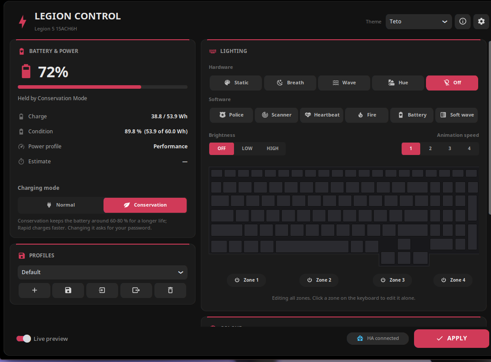

# Legion Control

Keyboard lighting, battery and charging control for Lenovo Legion laptops with a 4-zone RGB keyboard, for Linux. Built and tested on a **Legion 5 15ACH6H (Gen 6)** with KDE Plasma on Wayland; GNOME works too.



## Features

**Lighting**
* **Hardware effects:** Static, Breath, Wave (with direction) and Hue, run by the keyboard's own controller.
* **Software effects:** Police, Scanner, Heartbeat, Fire, Soft Wave and a **Battery gauge** that turns the keyboard into a charge meter (blinks red when low, calm red while charging).
* **Per-zone colours:** click a zone on the keyboard drawing to edit it alone, or click outside the keys to edit all four at once. Each zone has its own on/off button.
* **Colour tools:** saturation/value square and hue bar, hex and RGB fields, 8 presets, 12 recent colours, and a Z1 → Z4 gradient.
* **Live preview** sends every change straight to the keyboard; otherwise press **Apply**.
* **Profiles:** save, switch, import and export lighting setups as JSON.

**Battery and power**
* Charge, condition (capacity vs. design), wattage, time estimate and the current power profile (Fn+Q).
* **Charging mode:** Normal, **Conservation** (holds the battery around 60-80 % for a longer life) and **Rapid Charge** where the kernel supports it.

**App**
* Seven themes: Miku, Teto, Neru, Phrolova, Shorekeeper, Encore and MaoMao.
* Lives in the system tray when closed, so software effects keep running; launching it again brings the window back.
* Optional **Home Assistant** link (see below).

## Install

Needs Python 3.10+, Tk, and on GNOME the AppIndicator extension for the tray icon.

```bash
git clone https://github.com/Eagle10021/Legion-Controller.git
cd Legion-Controller
./run.sh            # first run creates a venv and installs requirements.txt
```

### USB access (required)

The lighting controller is a USB device, and Linux only lets root write to it by default. Add a udev rule once:

```bash
lsusb | grep -i "Integrated Technology Express"   # note the ID after 048d:, usually c965
echo 'SUBSYSTEM=="usb", ATTR{idVendor}=="048d", ATTR{idProduct}=="c965", MODE="0666"' \
  | sudo tee /etc/udev/rules.d/99-kblight.rules
sudo udevadm control --reload-rules && sudo udevadm trigger
```

If your `lsusb` shows a different product ID, use it in the rule and in `LedController.PRODUCT` (`legion_control/hardware.py`).

### App menu entry

```bash
./install-kde.sh    # KDE Plasma
./install.sh        # GNOME
```

These create a `.desktop` file pointing at this folder; run them again if you move it. `./run.sh --hidden` starts straight to the tray (handy for autostart).

### Charging mode permissions

Conservation and Rapid Charge are files under `/sys/bus/platform/drivers/ideapad_acpi/`, writable only by root, so changing the mode shows a password prompt (one per change). To skip the prompt, give your user write access with a udev rule of your own. Rapid Charge needs the kernel's `rapid_charge` file or the `acpi_call` module; without either, only Normal and Conservation are shown.

## Home Assistant

Legion Control can report to [Home Assistant](https://www.home-assistant.io) and take commands from it, so automations (or a voice assistant) can change the keyboard.

1. **In the app:** Settings (gear) → Home Assistant. Enter your HA URL and a long-lived access token (HA: your profile → Security). For commands, also set the address HA should reach this laptop on (a Tailscale IP works well), press **Generate command token**, then **Save & connect**. Changes apply immediately; the pill in the bottom bar shows the connection.
2. **In Home Assistant:** copy [`examples/home-assistant/legion_control.yaml`](examples/home-assistant/legion_control.yaml) into `config/packages/`, put the laptop's address in it, and add the command token to `secrets.yaml`. The file explains each step.

The app then keeps three entities up to date: `sensor.legion_battery` (% with charge mode, wattage, condition), `sensor.legion_keyboard` (effect, colours, brightness, profile) and `sensor.legion_power_profile`. The example package adds scripts to set a colour, effect, brightness or profile; their descriptions are written so an Assist/LLM agent picks the right one.

Commands are plain HTTP, so anything can send them:

```bash
curl -X POST http://LAPTOP:47125/keyboard -H "Authorization: Bearer TOKEN" \
     -d '{"color": "#39c5bb"}'    # or {"effect": "breath"}, {"brightness": "Off"}, {"profile": "Night"}
```

## Settings and files

* Settings and profiles: `~/.config/legion-control/config.json` (private, `0600`, since it can hold the HA token). An old `config.json` next to the script is migrated on first start.
* System info cache: `~/.cache/legion-control/`.
* Run with `--verbose` to see what's happening (USB errors, HA commands) in the terminal.

## Project layout

| Path | What's in it |
| :--- | :--- |
| `Legion_KBLight.py` | Launcher (kept under the old name so existing shortcuts work) |
| `legion_control/app.py` | The window: layout, events, loops, dialogs |
| `legion_control/hardware.py` | USB packets for the ITE 8295 lighting chip; charging mode through `ideapad_acpi` |
| `legion_control/effects.py` | Software effects, frame by frame |
| `legion_control/battery.py` | Battery readings from `/sys/class/power_supply` |
| `legion_control/widgets.py` | Keyboard drawing, colour picker, icons |
| `legion_control/themes.py` | Themes and colour presets: one line each |
| `legion_control/ha_link.py` | Home Assistant push and command server |
| `legion_control/settings.py` | Config file, defaults and migration |
| `legion_control/assets/` | Icon font (a subset of Material Design Icons) |
| `tools/make_icon_font.py` | Rebuilds the icon font: `python3 tools/make_icon_font.py new-icon-name` |
| `examples/home-assistant/` | Home Assistant package |
| `l5p-kbl/` | Reference implementation the USB code is based on |

**Other models:** the keyboard drawing in `widgets.py` (`_legion5_gen6_keys`) is measured from the Legion 5 Gen 6 keyboard. The lighting works on any 4-zone Legion with the same controller; if your layout differs, the key rectangles and `_ZONE_SPLITS` are the only things to change.

## Credits

* USB protocol from the [l5p-kbl](https://github.com/imShara/l5p-kbl) reverse-engineering work by Shara and Drakanio.
* Icons: [Material Design Icons](https://pictogrammers.com/library/mdi/) by Pictogrammers (Pictogrammers Free License, see `legion_control/assets/MDI-LICENSE.txt`).
* App icon: Senko Loaf (`images/Senko_Loaf.jpg`).

## License

MIT, see [LICENSE](LICENSE).
